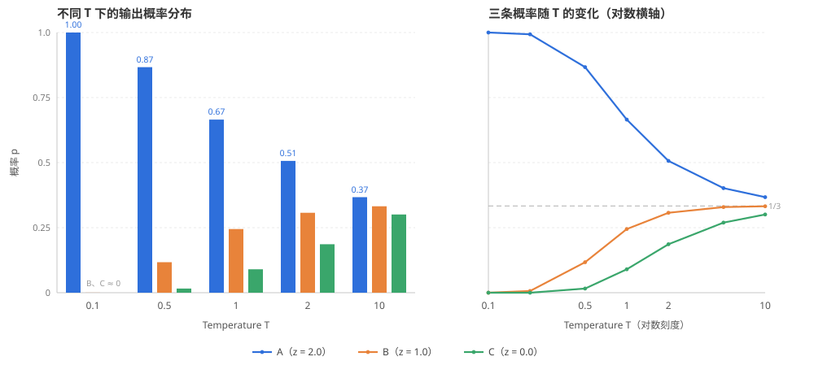

## 1 引子
在调用大模型时，很多开发者都会把 temperature 设为 0，期待同样的输入得到完全一致的输出。但实测却发现，即使输入一字不差，模型返回的结果仍可能不同：措辞变了，有时答案本身也不一样。按理说 temperature=0 意味着每次都选择概率最高的 token，随机性究竟从何而来？本文就从这一常见困惑出发，逐层拆解这个问题。


## 2 Temperature原理

### 2.1 从 logits 到概率分布

大模型每次输出时，需要先对词表中的每个 token（词表大小记为 $V$）给出一个未归一化的分数，称为 logits，记为 $z=(z_1,z_2,\dots,z_V)$。要把这些分数变成概率，最自然的做法是 softmax[[3]](#ref-3)——先取指数，再除以总和：

$$
p_i=\frac{\exp(z_i)}{\sum_{j=1}^{V}\exp(z_j)}
$$

这是最原始的 softmax[[5]](#ref-5)：分数高的 token 概率高，所有概率之和为 1。但它没有可调参数，分布的「尖锐程度」完全由 logits 自己决定。

Temperature这个参数并不是神经网络先发明的，它最早来自统计物理中的玻尔兹曼分布 $p_i\propto\exp(-\varepsilon_i/k_{\mathrm B}T)$（Boltzmann, 1868[[1]](#ref-1)；Gibbs 于 1902 年系统化[[2]](#ref-2)），其中 $k_{\mathrm B}T$ 就是温度尺度。随后 Hinton、Vinyals 和 Dean 在知识蒸馏（2015）[[4]](#ref-4)中首次把温度引入 softmax 输出层：$q_i=\exp(z_i/T)\big/\sum_j\exp(z_j/T)$，用升高温度来「软化」教师模型的输出分布。换句话说，$T$ 是把玻尔兹曼分布里的温度原样搬进了神经网络。

于是有了带温度的 softmax：

$$
p_i(T)=\frac{\exp(z_i/T)}{\sum_{j=1}^{V}\exp(z_j/T)}
$$

当 $T=1$ 时，它退化为上面不带 $T$ 的原始 softmax。$T$ 越大，$z_i/T$ 被压平，分布越接近均匀分布，低概率的 token 也有机会被选中；$T$ 越小，$z_i/T$ 被放大，分布越尖锐，结果越接近取最高分。也就是说，Temperature 不改变 token 之间的排序，只改变它们概率的「相对差距」。

### 2.2 一个实际的计算例子

公式有点抽象，拿三个 token 手算一遍就直观了。设词表只有 A、B、C 三个 token，logits 依次为 $z=(2.0, 1.0, 0.0)$，分别除以不同的 $T$ 再做 softmax。以 $T=2$ 为例：

$$
\frac{z}{T}=(1.0, 0.5, 0.0)  \xrightarrow{ \exp }  (2.718, 1.649, 1.000)  \xrightarrow{ \text{归一化} }  p=(0.506, 0.307, 0.186)
$$

即 $e^{1.0}=2.718$、$e^{0.5}=1.649$、$e^{0}=1$，三者之和为 $5.367$，各自除以它便得到概率。把 $T$ 从很小一路调到很大，结果如下：

| $T$ | $p_A$ | $p_B$ | $p_C$ | $p_A/p_C=e^{2/T}$ | 熵 $H$（nats） |
| --- | --- | --- | --- | --- | --- |
| 0.1 | 0.99995 | 0.00005 | 0.00000 | $4.85\times10^{8}$ | 0.0005 |
| 0.5 | 0.8668 | 0.1173 | 0.0159 | 54.6 | 0.4412 |
| 1.0 | 0.6652 | 0.2447 | 0.0900 | 7.39 | 0.8323 |
| 2.0 | 0.5065 | 0.3072 | 0.1863 | 2.72 | 1.0201 |
| 10.0 | 0.3672 | 0.3322 | 0.3006 | 1.22 | 1.0954 |
| $\to\infty$ | 0.3333 | 0.3333 | 0.3333 | 1 | 1.0986 |

最后一行是参照系：$1/3=0.3333$ 即均匀分布，而 $\ln 3\approx1.0986$ 是三个 token 上熵的上限。



*图 1：左图为 $T$ 取 0.1、0.5、1、2、10 时三个 token 的概率分布；右图为三条概率随 $T$ 的变化曲线，横轴为对数刻度，灰色虚线为均匀分布 $1/3$。*

从表和图里可以读出三件事：

1. **排序不变**：无论 $T$ 取多少，始终是 $p_A>p_B>p_C$，Temperature 只改「差多少」。
2. **差距被拉平**：$p_A$ 与 $p_C$ 的差距从 $T=0.1$ 时的 0.99995，缩小到 $T=10$ 时的 0.067，并在 $T\to\infty$ 时归零；$p_A/p_C$ 也正好沿着 $e^{2/T}$ 从 $4.85\times10^{8}$ 收敛到 1。
3. **熵单调上升**：$H$ 从 0.0005 增至 1.0954，逼近均匀分布的 1.0986。熵越高，采样时越「敢」选到 B、C 这类次优 token。

这段表用几行代码即可复现：

```python
import numpy as np

z = np.array([2.0, 1.0, 0.0])
for T in [0.1, 0.5, 1.0, 2.0, 10.0]:
    s = z / T
    p = np.exp(s - s.max())
    p /= p.sum()
    H = -(p * np.log(p)).sum()
    print(f"T={T:>4}: p={np.round(p, 4)}, H={H:.4f}")
```

### 2.3 两个极端：$T\to 0$ 与 $T\to\infty$

设得分最高的两个 token 为 $(1)$ 和 $(2)$，记 $\Delta=z_{(1)}-z_{(2)}>0$，则二者的概率之比只取决于温度：

$$
\frac{p_{(1)}(T)}{p_{(2)}(T)}=\exp\left(\frac{\Delta}{T}\right)
$$

当 $T\to 0^{+}$ 时，该比值趋于无穷，概率质量全部压到得分最高的 token 上：

$$
\lim_{T\to 0^{+}}p_i(T)= \begin{cases} 1, & i=\arg\max_j z_j, \\\\ 0, & i\neq\arg\max_j z_j. \end{cases}
$$

这正是 greedy decoding：每一步都取概率最高的 token。反过来，当 $T\to\infty$ 时 $z_i/T\to 0$，$p_i\to 1/V$，退化为在整个词表上均匀乱选。而 $T=1$ 对应的，才是模型训练时学到的原始分布。

### 2.4 实现上的几个细节

- **数值稳定性**：计算时先减去 logits 的最大值，即 $\exp(z_i/T-\max_j z_j/T)$，避免指数溢出。
- **缩放顺序**：在 Transformers（HuggingFace 的库）等主流库中，采样顺序通常是 temperature 缩放 → top-k（只保留分数最高的 $k$ 个候选）→ top-p（只保留累计概率达到 $p$ 的最小候选集）→ 采样。因为 top-p 的截断位置依赖于缩放后的概率，所以温度和 top-p 并非互不影响。
- **$T=0$ 是特例**：公式在 $T=0$ 处除零无定义，因此各框架要么把它当作 greedy 的特殊开关，要么用一个极小的正数（如 $10^{-5}$）替代。

一个最小实现大致如下：

```python
import numpy as np

def sample_token(logits, T=1.0):
    z = np.asarray(logits, dtype=np.float64) / T
    exp = np.exp(z - z.max())        # 减去最大值，数值稳定
    probs = exp / exp.sum()         # softmax
    return np.random.choice(len(probs), p=probs)

print(sample_token([2.0, 1.0, 0.1], T=1.0))
print(sample_token([2.0, 1.0, 0.1], T=0.1))  # 几乎总是 0
```

到这里，理论上 $T=0$ 应该给出完全确定的输出。可为什么实际调用 API 时，即使设置成 0，结果仍会变化？这就是下一节要讨论的问题。

## 3 输出随机性的由来

把 $T$ 调到 0，只是把「采样」这一步变成了确定性的 $\arg\max$，但从请求进入网关到吐出 token，中间还有一整条数值计算链路。随机性其实有两层：**采样随机性**（设计如此，可控）和**数值非确定性**（工程副作用，难控）。

### 3.1 第一层：采样随机性

$T>0$ 时，模型每一步给出的是概率分布而不是某个确定的 token，然后从分布里抽签：

$$
p(y_t \mid y_{<t}) = \operatorname{softmax}\left(\frac{z(y_{<t})}{T}\right), \quad y_t \sim \mathrm{Categorical}(p)
$$

这里的 $\mathrm{Categorical}(p)$ 就是「按概率 $p$ 抽一个类别」。

整段输出的概率是各步条件概率的连乘：

$$
P(y_{1:T}) = \prod_{t=1}^{T} p(y_t \mid y_{<t})
$$

采样器用随机数决定抽到哪个 token。种子不同，第一个分叉点就可能出现在任何位置；而一旦某个 token 不同，它就会进入下一步的上下文，后续所有计算的条件都变了——这是自回归的级联放大。这一层随机性是「设计出来」的，也完全可控：$T=0$ 即 greedy，或者固定 seed 并保证同一套引擎与部署。

但是，为了实现上的简洁，很多推理引擎对于Temperature=0的这种特殊情况，只是将Temperature设置成了一个极小的正数来近似。

### 3.2 第二层：数值随机性

假设推理引擎$T=0$ 之后使用贪心采样，但 logits 本身并不是每次都完全相同——哪怕输入、权重、硬件都没变。根源要从浮点数讲起。

后面会反复出现几个名词，先用一句话对齐（记不住也没关系，读到再回来查）：

| 名词 | 一句话解释 |
| --- | --- |
| kernel（GPU 内核） | GPU 上并行执行的一个函数：由 CPU 端启动，大量线程同时执行同一段代码。它通常是某个「算子」（如矩阵乘、softmax）在特定精度、形状下的一种具体实现，一个算子常对应多个 kernel；注意不是操作系统内核 |
| 归约（reduction） | 把一串数合并成一个数，比如求和、求最大值；softmax 的分母、attention 的加权和都是归约 |
| 原子加（atomicAdd） | 多线程同时加一个变量时，保证不漏加、不覆盖的硬件指令 |
| split/tree reduction | 把长向量切成几段并行求和，再按树形把各段结果合并；切几段、怎么合并决定了加法顺序 |
| tile（分块） | 矩阵乘把输出切成小块，每块交给一个核心独立计算；块的大小决定用哪条 tensor-core 指令、K 维每次累加多少 |
| split-K | 矩阵乘沿着累加维 K 切开并行算，最后把各部分和相加 |
| cuBLAS | NVIDIA 的 GPU 线性代数库（BLAS 指「基础线性代数子程序」），矩阵乘、矩阵向量乘等运算通常默认走它 |
| CUTLASS | NVIDIA 开源的矩阵乘（GEMM，通用矩阵乘）模板库，很多高性能 kernel 由它生成或参考它实现 |
| tensor core（张量核心） | GPU 中专门做小规模矩阵乘加的硬件单元，一条指令算一小片；不同指令的累加顺序可能不同 |
| batch invariance（批不变性） | 同一个输入，无论和多少条其他请求拼成一批，结果都应该逐 bit 相同 |
| run-to-run 确定性 | 同一个程序、同样的输入跑两遍，结果逐 bit 一致 |
| chunked prefill | 把长 prompt 切成几块分批送进模型，而不是一次性算完 |
| prefix caching（前缀缓存） | 复用之前算过的上下文 KV（Key/Value 缓存），避免重复计算|
| MoE / expert capacity | 混合专家模型，每个 token 只走少数几个专家；每个专家有容量上限，超限时会改派或丢弃 token |
| speculative decoding（投机解码） | 先用小模型猜几个 token，再让大模型一次性并行验证 |
| 动态量化（per-batch scale） | 按当前批次的统计值（通常是最大值）算缩放因子，把数值压到 FP8/FP4（8 位 / 4 位浮点）精度 |

#### 3.2.1 根因：浮点加法不满足结合律

$$
(a+b)+c \neq a+(b+c)
$$

这不是数学错误，而是有限精度带来的舍入。例如：

```
(0.1 + 1e20) - 1e20   # -> 0.0
0.1 + (1e20 - 1e20)   # -> 0.1
```

同样的三个数、两种加法顺序，一个得到 0，一个得到 0.1。这不是个例：在 FP64（双精度浮点）下，把 $10^{-10},10^{-5},10^{-2},1$ 这四个数连同它们的相反数（共 8 个数）打乱顺序求和，能得到 102 种不同的结果。BF16 的尾数只有 8 位有效精度（显式尾数 7 位，FP32 是 24 位），FP8/FP4 更少，舍入更狠，顺序带来的差异只会更大。大模型一次前向就是上亿次乘加，归约顺序一变，logits 就能差出可观的数值。

#### 3.2.2 流行解释为什么站不住

一种流传很广的说法是：并发线程完成顺序不确定，而累加顺序又依赖线程完成顺序（比如用 atomic add），于是累加顺序也不确定。

2025 年 Thinking Machines 的实验[[6]](#ref-6)推翻了这种观点：

- 同一个 kernel、同样的输入，重复跑 1000 次，结果 **bitwise 完全相同**；
- LLM 前向里几乎不存在 atomicAdd，batch 维的并行通常已经足够，归约用 split/tree reduction 加固定收尾。

也就是说，单次 kernel 调用是「run-to-run 确定」的。问题不在一次执行内部，而在**每次执行时 kernel 的形状不同**，也就是模型推理过程用的kernel不具备batch invariance（批不变性）。

#### 3.2.3 主因：缺少 batch invariance

矩阵乘在数学上逐行独立，实现上却不是：cuBLAS/CUTLASS 会根据矩阵形状（M、N、K）选择不同的 tile 大小、是否 split-K、用哪条 tensor-core 指令，而这些选择都会改变归约顺序。于是：

$$
f(x; \text{batch}=1) \neq f(x; \text{batch}=64)
$$

同一行数据，单独算与放进 batch 里算，结果可以不同。而在线推理的 batch 大小取决于「此刻有多少请求」，对单个用户来说是一个不可控的外部变量。**所以主因是：负载波动导致 batch 大小波动，而 kernel 不满足 batch invariance。**

Attention 还多一层：序列被切成几段（chunked prefill、prefix caching）同样会改变归约顺序——同一个 token 的结果，取决于它和其他多少个 token 被同时处理。

Thinking Machines 的实验[[6]](#ref-6)：Qwen3-235B-A22B，$T=0$，同一个 prompt 采样 1000 次、每次 1000 个 token：

- 得到 **80 种**不同输出，最常见的一种出现 78 次；
- 前 102 个 token 完全相同，从第 103 个开始分叉；
- 992 次生成 "Queens, New York"，8 次生成 "New York City"；
- 换成 batch-invariant 内核后，1000 次输出完全一致。

#### 3.2.4 引擎实现还会继续放大

- **动态批处理**：每个请求的 batch 组成、大小都有可能不同；
- **前缀缓存 / chunked prefill**：序列切法变，attention 的归约顺序跟着变；
- **MoE**：路由分数接近时，微小数值差可能改变选中的专家；专家容量满了还会 token dropping 或改派；
- **投机解码**：验证阶段一次并行验证多个 token，矩阵形状随草稿命中情况动态变化；
- **动态量化**：FP8/FP4 按 batch 统计 max 决定缩放比例，同批次其他人的数据会改变你的 scale；
- **多卡 / 多副本 / 版本差异**：张量并行、路由到不同副本、不同 GPU 型号或库版本，数值都会不同。

这些因素在真实服务里往往同时出现，社区中关于这个问题的经验总结[[7]](#ref-7)也主要围绕这几类展开。

### 3.3 误差为什么会被放大成完全不同的文章

假设某一步，两个候选 token 的 logits 是 $15.123456$ 和 $15.123455$，前者是「尽管」，后者是「虽然」。数值噪声只要到 $10^{-6}$ 量级，$\arg\max$ 就可能翻转。一旦第 10 个 token 变成「虽然」，第 11 步的上下文就变了，attention 权重、后续 logits 全部改变，整段话走向完全不同的分支。

### 3.4 能不能做到完全确定？

- **采样层**：$T=0$，或固定 seed（且固定同一引擎与部署）；
- **数值层（单机单请求）**：开启 `torch.use_deterministic_algorithms(True)`、固定 `CUBLAS_WORKSPACE_CONFIG`、关掉动态批处理；
- **数值层（服务端）**：需要 batch-invariant 内核。Thinking Machines 实现后 1000 次输出完全一致，代价是矩阵乘（matmul）约 20% 的性能损失；端到端在未优化时从 26s 涨到 55s（优化后 42s，Qwen3-8B、单卡、1000 条短序列）。

所以工程上只有两条路：接受不确定性，或者用吞吐换确定性。多数线上服务选前者，同时靠结构化输出、校验、重试来兜底。

### 3.5 小结

| 随机性来源 | $T=0$ 能消除吗 | 典型触发 |
| --- | --- | --- |
| 采样 | 能 | $T>0$、seed 不同 |
| 浮点归约顺序 / 缺 batch invariance | 不能 | batch 大小、序列切法、负载 |
| 引擎优化（MoE、投机解码、动态量化） | 不能 | 负载、路由、量化开关 |
| 硬件 / 库版本 / 多副本 | 不能 | 部署差异 |


## 4 如何缓解随机性

## 5 参考资料

文中方括号数字对应下列文献的编号。

1. <a id="ref-1"></a>Boltzmann, L. (1868). *Studien über das Gleichgewicht der lebendigen Kraft zwischen bewegten materiellen Punkten*. Wiener Berichte, 58, 517–560.
2. <a id="ref-2"></a>Gibbs, J. W. (1902). *Elementary Principles in Statistical Mechanics*. Yale University Press.
3. <a id="ref-3"></a>Bridle, J. S. (1990). *Probabilistic Interpretation of Feedforward Classification Network Outputs, with Relationships to Statistical Pattern Recognition*. NATO ASI Series F, 68, 227–236. [doi:10.1007/978-3-642-76153-9_28](https://doi.org/10.1007/978-3-642-76153-9_28)
4. <a id="ref-4"></a>Hinton, G., Vinyals, O., & Dean, J. (2015). *Distilling the Knowledge in a Neural Network*. [arXiv:1503.02531](https://arxiv.org/abs/1503.02531)
5. <a id="ref-5"></a>[Softmax function — Wikipedia](https://en.wikipedia.org/wiki/Softmax_function)
6. <a id="ref-6"></a>He, H., & Thinking Machines Lab (2025). *Defeating Nondeterminism in LLM Inference*. [thinkingmachines.ai](https://thinkingmachines.ai/blog/defeating-nondeterminism-in-llm-inference/)
7. <a id="ref-7"></a>知乎讨论：[同一个 prompt 重复多次输入进 LLM，为啥得到的输出都不一样？](https://www.zhihu.com/question/1935362750470656960)
